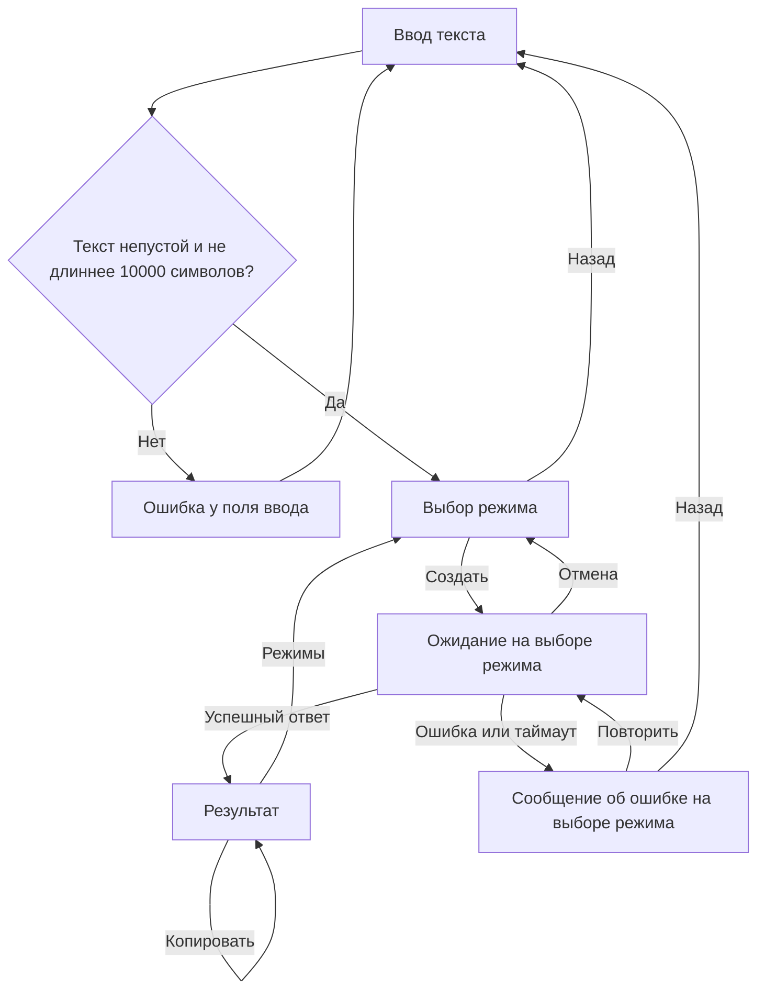

# Архитектура приложения: экраны и переходы

Статус на 28.10.2026: логика согласована Ариной Старыниной (design) 27.10 в 22:21
в ответ на документ «Логика-экранов-для-дизайна.md»: «Все нормально, поправлять ничего не надо, замечаний никаких нет».
Подтверждение передано Артёмом Лебедевым. Код экранов принят в main через PR #17.
Согласование относится к логике; готовность макетов подтверждается отдельно.
Основа — присланные Кристиной wireframes выбора режима/результата и схема Flows.

## Объём первой версии

Три экрана: **Загрузка материала → Выбор режима → Результат**.
«Главная» означает загрузку материала. Отдельные Chat и Main не нужны для этого сценария.
Для первого спринта материал вводится текстом, поддерживается краткий конспект.
Остальные четыре режима показаны с пометкой «скоро» и недоступны для выбора.
Импорт TXT/PDF/DOCX в эту реализацию не входит: серверная загрузка файлов пока является заглушкой.
Поле ввода — временная компоновка до макета Арины.

## Таблица экранов

| Экран | Назначение | Откуда | Действия и переходы | Состояния |
|---|---|---|---|---|
| Загрузка материала | Ввести или вставить текст; проверить связь с сервером | Запуск приложения; «Назад» с выбора режима | «Выбрать режим»: проверить текст и открыть режимы; «Проверить связь»: остаться здесь и показать результат проверки | Пустое/заполненное поле, ошибка проверки текста, ожидание/ошибка проверки связи |
| Выбор режима | Выбрать способ обработки и отправить материал | Загрузка материала; «Режимы» с результата | «Создать»: один запрос; успешный ответ открывает результат; «Назад»: материал; «Отмена»: прекратить ожидание, вернуться к выбору; «Повторить»: новый запрос с прежними текстом и режимом | Выбор, ожидание, долгое ожидание, ошибка обработки |
| Результат | Прочитать и скопировать ответ | Только успешная обработка | «Копировать»: скопировать ответ; «Режимы»: вернуться к выбору с сохранённым материалом | Готовый результат, подтверждение копирования |

## Однозначная схема для макетов

## Правила поведения

1. Пустой/пробельный текст и превышение 10 000 Unicode-символов блокируют переход к режимам. Сетевой запрос не отправляется.
2. По умолчанию выбран «Краткий конспект». Пока запрос выполняется, повторная отправка недоступна.
3. Ждём ответ **на экране выбора режима**. Через 20 секунд показываем подсказку о долгом ожидании. Ожидание продолжается само; повторный POST не запускается.
4. Переходим на результат только после получения корректного непустого ответа. Дополнительной загрузки на экране результата нет: контракт синхронный, частичный результат не приходит.
5. Ошибка сервера, сети, таймаут или некорректный ответ показываются на выборе режима. «Повторить» явно отправляет новый запрос; «Назад» открывает материал.
6. «Отмена» прекращает ожидание в приложении и возвращает выбор режима. Сервер может продолжать уже начатую обработку. Поздний ответ не меняет экран и не затирает результат следующего запроса.
7. Текст и режим сохраняются при переходах, ошибке, отмене и повороте устройства. При изменении материала старый результат очищается. Сохранение после завершения процесса приложения пока не реализовано.
8. Системная кнопка «Назад»: результат → режимы → материал. Во время запроса она сначала отменяет ожидание.
9. Проверка связи доступна на вводе материала, не требует текста и не создаёт конспект. `status = ok` подтверждает только доступность backend, а не готовность LLM.

## API и ограничения

Приложение использует `GET /health` и `POST /api/v1/text/process` с JSON `{text, mode}`.
Ключ LLM остаётся только на сервере. Адрес backend задаётся в `api/ServerConfig.kt`.

Проверенный рабочий контракт: [backend PR #16, openapi.yaml на 86a760c5](https://github.com/study-ai-assistant/backend/blob/86a760c5f19a00d674f20ad492e715d304198fb5/docs/api/openapi.yaml).
На 27.10 PR backend ещё открыт; в `main` контракт пока пустой.
Обработчик поддерживает только `SHORT_SUMMARY`; список `/api/v1/modes` не означает готовность всех режимов.

Идентификаторы остальных режимов: `DETAILED_SUMMARY`, `SIMPLE_EXPLANATION`,
`KEY_TERMS`, `SELF_CHECK_QUESTIONS`. Включать их нужно после проверки реализации backend.

## Согласование с design

Статус на 28.10.2026: логика экранов и переходов согласована с design.
Код экранов принят в main через PR #17. Макеты находятся в работе.

- [User flow mobile#1](https://github.com/study-ai-assistant/mobile/issues/1).
- [Wireframes mobile#3](https://github.com/study-ai-assistant/mobile/issues/3).
- [Согласование списка экранов mobile#5](https://github.com/study-ai-assistant/mobile/issues/5).
- Ссылки на конкретные фреймы добавить после публикации в Figma.
- [Таблица экранов в wiki «Архитектура приложения»](https://github.com/study-ai-assistant/mobile/wiki/Архитектура-приложения).
- [Актуальный user flow из комментария Кристины в #1](https://www.figma.com/design/mfGaM00iqFy7L5DzTJn1K2/ИИ-помощник-для-учебы?node-id=37-67).
- Согласование логики не означает завершение wireframes #3 или демонстрацию по #6.
